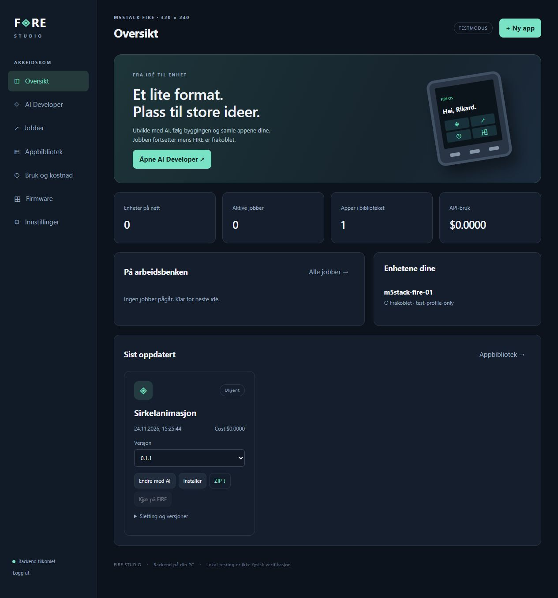

# FIRE OS for M5Stack FIRE

FIRE OS samler lokale apper, direkte Home Assistant-styring, AI-dialog og
Lua-appbygging. AI og FIRE Studio bruker den lokale Windows-backenden.
Home og firmwareoppdatering har egne direkte forbindelser.

Begynn med [samlet oppsett](SETUP.md). Se [leveransestatus](STATUS.md) for
forskjellen mellom implementert, lokalt testet og fysisk verifisert.

| Mappe | Formål |
| --- | --- |
| [M5Stack-backend](M5Stack-backend/) | Lokal PC-backend for FIRE OS AI Developer. All videre backendutvikling skjer her. |
| [M5Stack-device](M5Stack-device/) | FIRE OS-firmware for M5Stack FIRE, bygget med PlatformIO. |

Åpne Windows-programmet med `M5Stack-backend/start-ui.ps1` og klikk
**Åpne FIRE Studio ↗** for nettlesergrensesnittet. For en isolert mockserver:

```powershell
.\M5Stack-backend\start.ps1 -Mock
```

I en annen terminal:

```powershell
.\M5Stack-backend\mock.ps1 -Demo
```

Bruk `/build` for å bekrefte bygging, `/run` for å bekrefte PC-simulering og
`/quit` for å avslutte. Mock-modus bruker ingen OpenAI-nøkkel eller betalte API-kall.

Ikke bruk en generell upload-kommando som førstegangsmigrering. Ny løsning for
uavhengig redning krever samordnet bootloader, partisjoner og firmware.
Følg den eksakte [deviceveiledningen](M5Stack-device/README.md).

Se [status](STATUS.md), [arbeidsinstruksjoner](AGENTS.md),
[deviceveiledning](M5Stack-device/README.md),
[backendveiledning](M5Stack-backend/README.md) og
[WebSocket-protokoll](M5Stack-backend/docs/PROTOCOL.md).

Fysisk integrasjon følger [protokoll 0.2](M5Stack-backend/docs/PROTOCOL-v0.2.md)
og [Lua-API](M5Stack-backend/docs/LUA_API.md). Direkte Home følger
[Home v1](M5Stack-backend/docs/HOME-v1.md). AI-apper er avgrensede Lua-pakker;
de kan ikke installere firmware eller skaffe nye HA-tillatelser.

FIRE Studio, kontrollert i en isolert mockprofil:



Bildet er en faktisk nettlesertest. Det er ikke bevis for fysisk FIRE,
live Cloudflare, Home Assistant eller nye betalte OpenAI-kall.
